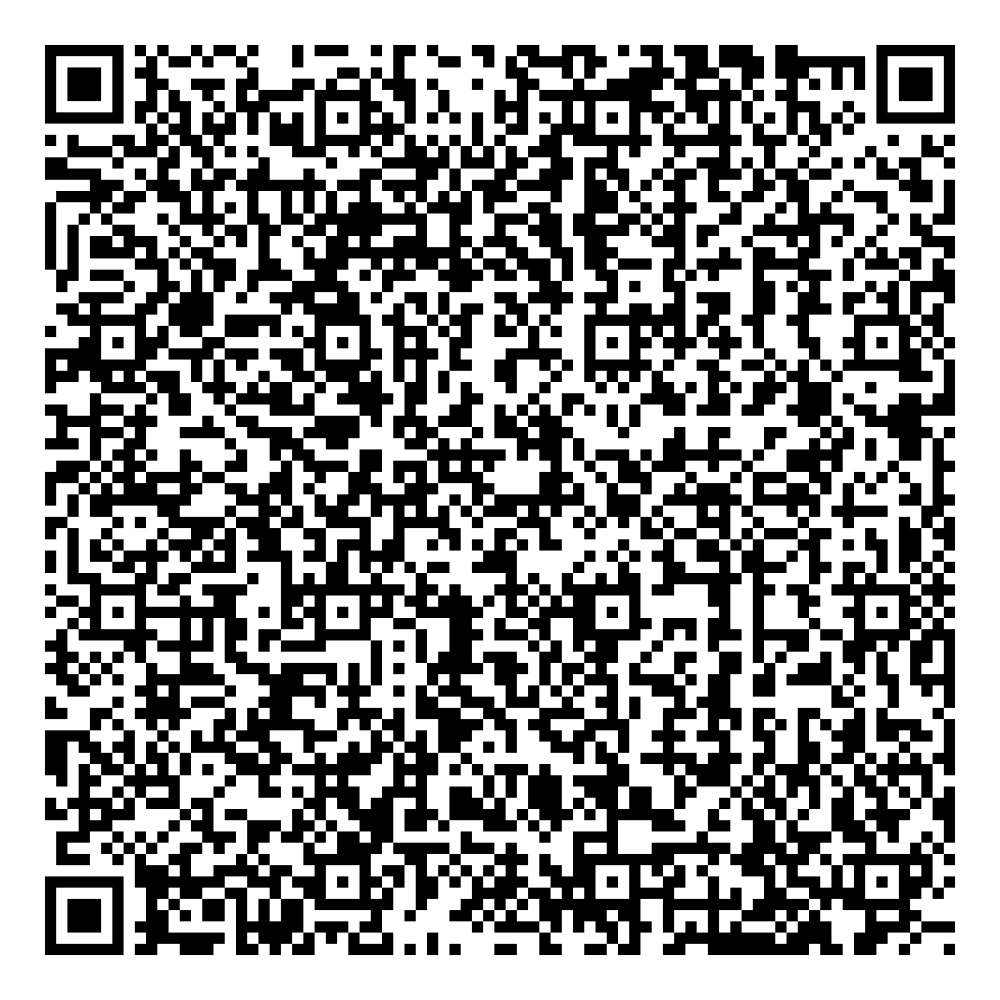

# 공신폰 설정

현재 배포 버전: **1.6.0** · [전체 릴리스](https://github.com/careconnect-team/gongsin-phone/releases)

Galaxy 공기계에서 QR 등록과 앱 제한 동작을 확인한 테스트 APK입니다.

[최신 APK 다운로드](https://github.com/careconnect-team/gongsin-phone/releases/latest/download/gongsin-setup.apk)

## 새 기기 초기 설정용 QR

새 기기 또는 백업 후 초기화한 기기의 초기 설정에서 사용하세요. 일반 APK 설치만으로 기기 소유자 권한은 활성화되지 않습니다.

이 QR은 새 버전이 나와도 그대로 사용합니다. 등록할 때 항상 최신 릴리스의 APK를 내려받고, APK 파일 대신 서명 인증서로 진위를 확인합니다. 인쇄할 때는 가로세로 4cm 이상을 권장합니다.

## 업데이트

앱이 하루 한 번 새 버전을 확인해 스스로 설치합니다. 관리자 화면의 **앱 업데이트**에서 마지막 확인 결과를 보고, **지금 업데이트 확인**으로 바로 확인할 수 있습니다.

1.4.3 이하가 설치된 기기는 관리자 화면에서 학습 제한을 해제한 뒤 위 최신 APK를 한 번 직접 설치하세요. 그 뒤로는 자동으로 업데이트됩니다. 모든 버전은 같은 서명 인증서를 사용합니다.

## 1.6.0 변경 사항

- 학습 제한이 적용되어 있으면 영상 사이트(유튜브, 틱톡, 카카오 숏폼 등)를 자동으로 차단합니다. 카카오톡 안의 링크와 영상 재생에도 적용됩니다. 안드로이드 10 이상에서 동작합니다.
- 학습 제한 중에는 개인 DNS 설정을 바꿀 수 없습니다.
- APK SHA-256 (1.6.0): `0d16209eb39f7b74927ee754e1e1f5369f35fbe3f8fca64c930f642afede004b`

## 1.5.10 변경 사항

- 학습 제한을 해제한 상태의 관리자 화면에 '구글 계정' 항목을 추가했습니다. 자녀 폰에서 바로 새 구글 계정을 만들고(웹 가입 페이지) 로그인할 수 있습니다.

## 1.5.9 변경 사항

- 화면의 불필요한 설명 문구를 줄이고 꼭 필요한 안내만 남겼습니다.

## 1.5.8 변경 사항

- 관리자 화면과 앱 선택 화면의 색을 차분한 샌드 베이지로 바꿔 눈부심을 줄였습니다.

## 1.5.7 변경 사항

- 학습 제한 중에는 계정 추가·삭제와 위치 끄기도 막아 가족 위치 공유가 꺼지지 않게 했습니다.
- 학습 제한을 풀지 않고 숨길 앱을 바꿀 수 있습니다. 저장하면 바뀐 앱만 바로 숨기거나 보입니다.
- 관리자 화면 색을 새 아이콘에 맞추고 안내 문구를 줄였습니다.

## 1.5.6 변경 사항

- 가족 위치 공유 화면의 문구를 정리했습니다.

## 1.5.5 변경 사항

- 관리자 화면에 가족 위치 공유(Samsung Find) 안내와 바로가기를 넣었습니다. Samsung Find·Find My Mobile·삼성 계정 앱은 숨기지 않습니다.

## 1.5.4 변경 사항

- 앱 아이콘을 밝은 코랄 오렌지 바탕에 왕관과 '공신' 글자로 바꿨습니다.

## 1.5.3 변경 사항

- 기능 변경은 없습니다.

## 1.5.2 변경 사항

- 자동 업데이트가 설치되지 않던 오류를 고쳤습니다. 서명 인증서 확인은 안드로이드가 업데이트를 설치할 때 직접 합니다.

## 1.5.1 변경 사항

- 관리자 화면을 간단히 했습니다. '앱 업데이트'에는 **지금 업데이트 확인** 버튼과 그 아래 확인 결과만, '기기 관리'에는 등록 해제 버튼과 버전만 표시합니다.
- 업데이트 확인 결과는 팝업 대신 버튼 아래에 바로 표시합니다.

## 1.5.0 변경 사항

- **자동 업데이트:** 하루 한 번 새 버전을 확인해 사용자 확인 없이 설치합니다.
- 학습 제한 중에도 업데이트됩니다. 설치하는 동안만 앱 설치 금지를 풀고, 새 버전이 시작되면 바로 다시 겁니다. 설치에 실패하거나 재부팅해도 제한은 다시 걸립니다.
- 내려받은 파일의 SHA-256, 패키지 이름, 버전, 서명 인증서가 모두 맞을 때만 설치하며, 낮은 버전으로는 내려가지 않습니다.
- 앱 아이콘을 남색 바탕에 크림색 '공신' 글자와 금색 밑줄로 바꿨습니다.
- 관리자 화면 아래 버전 표기가 실제 설치된 버전을 보여 줍니다.
- 인터넷 권한과 부팅 완료 권한을 추가했습니다. 업데이트 확인·다운로드와 재부팅 뒤 제한 복구에만 씁니다.

## 1.4.3 변경 사항

- 숨길 앱 선택 화면에서 **앱 이름 검색**을 제거했습니다. 공신폰은 초기화한 기기에서 앱을 최소한으로 사용하는 것을 전제로 합니다.
- 앱 선택을 한 번도 저장하지 않은 기기는 숨길 앱 선택을 처음 열 때 **공신폰 모드가 자동으로 선택**됩니다. 필요한 앱만 체크를 해제하고 저장하세요.
- 이미 저장한 선택이 있으면 그대로 보여 주며 자동으로 바꾸지 않습니다.
- “선택을 저장한 뒤 관리자 화면에서 학습 제한을 적용하세요” 안내 문구를 제거했습니다.

## 공신폰 모드

- 앱 분류 문구는 **집중 관리 앱 / 기타 설치 앱**입니다.
- **공신폰 모드 선택**은 전화·연락처·메시지·카메라·갤러리·시계·캘린더로 식별된 기본 앱을 제외한, 목록에 있는 모든 앱을 선택합니다. 홈 화면과 필수 시스템 앱은 차단 대상에서 제외됩니다. 버튼을 다시 누르면 현재 선택을 공신폰 모드 선택으로 되돌립니다.
- 학습 앱도 기본 앱 7종에 해당하지 않으면 선택됩니다. 필요한 앱은 개별적으로 체크를 해제하세요. **전체 선택 해제**도 제공됩니다.
- 학습 제한 전에는 **저장 → 학습 제한 적용** 순서로 차단되고, 학습 제한 중에는 저장하면 바로 반영됩니다. 취소하면 저장하지 않습니다.
- 기본 앱은 삼성·Google·Android의 알려진 패키지와 기본 전화/SMS 역할, 시스템 앱 카테고리로 식별합니다. 기기별 기본 앱 변형을 모두 보장하지 않으므로 적용 전 선택 목록을 확인하세요.

## 보안 및 제한

관리자 비밀번호와 12자리 복구 코드를 설정한 뒤 사용합니다. 복구 코드는 휴대전화 밖에 보관하세요. 앱 화면은 캡처되지 않습니다. 복구하면 새 코드를 발급하며 이전 코드는 폐기합니다.

선택 앱 숨김, 설치·삭제 제한, 설정 메뉴 초기화 제한, 계정 변경·위치 끄기 제한 등을 적용합니다. 위치·메시지 수집 기능은 없습니다. 인터넷은 업데이트 확인과 새 버전 다운로드에만 쓰며, 요청에 기기 정보나 개인정보를 담지 않습니다. GitHub 서버에는 일반 웹 요청처럼 접속 IP가 남습니다. 삼성/Android의 조직 관리 시스템 문구는 남습니다. 모든 우회 경로나 펌웨어 초기화를 막는 제품은 아닙니다.

## 검증

1.5.10: 빌드, v2/v3 서명 검사, 이전 버전과 인증서 일치, 단위 테스트를 확인했습니다. 배포 뒤 고정 QR 주소와 업데이트 정보(`version.json`)가 v1.5.10을 가리키고, 내려받은 APK가 이 릴리스와 같은 것을 확인했습니다. 관리 등록된 기기에서 웹으로 만든 계정의 로그인은 실기기에서 확인하지 않았습니다.

1.5.9: 빌드, v2/v3 서명 검사, 이전 버전과 인증서 일치, 단위 테스트를 확인했습니다. 배포 뒤 고정 QR 주소와 업데이트 정보(`version.json`)가 v1.5.9를 가리키고, 내려받은 APK가 이 릴리스와 같은 것을 확인했습니다.

1.5.8: 빌드, v2/v3 서명 검사, 이전 버전과 인증서 일치, 단위 테스트를 확인했습니다. 배포 뒤 고정 QR 주소와 업데이트 정보(`version.json`)가 v1.5.8을 가리키고, 내려받은 APK가 이 릴리스와 같은 것을 확인했습니다.

1.5.7: 빌드, v2/v3 서명 검사, 이전 버전과 인증서 일치, 단위 테스트를 확인했습니다. 배포 뒤 고정 QR 주소와 업데이트 정보(`version.json`)가 v1.5.7을 가리키고, 내려받은 APK가 이 릴리스와 같은 것을 확인했습니다.

1.5.4: 빌드, v2/v3 서명 검사, 1.5.3과 인증서 일치, 단위 테스트를 확인했습니다. 배포 뒤 고정 QR 주소와 업데이트 정보(`version.json`)가 v1.5.4를 가리키는 것을 확인했습니다.

1.5.3: 빌드, v2/v3 서명 검사, 1.5.2와 인증서 일치, 단위 테스트를 확인했습니다. 배포 뒤 고정 QR 주소와 업데이트 정보(`version.json`)가 v1.5.3을 가리키는 것을 확인했습니다. 공기계에서 1.5.2가 1.5.3을 스스로 설치하는 것을 확인했습니다.

1.5.2: 빌드, v2/v3 서명 검사, 1.5.1과 인증서 일치, 단위 테스트를 확인했습니다. 서명 인증서 비교 코드가 앱에서 빠지고 패키지·버전 확인과 설치 단계는 그대로인 것을 확인했습니다. 배포 뒤 고정 QR 주소와 업데이트 정보(`version.json`)가 v1.5.2를 가리키고, 내려받은 APK의 SHA-256이 맞는 것을 확인했습니다.
1.5.1: 빌드, v2/v3 서명 검사, 1.5.0과 인증서 일치, 단위 테스트, 지운 문구가 앱 코드에서 빠진 것을 확인했습니다. 배포 뒤 고정 QR 주소와 업데이트 정보(`version.json`)가 v1.5.1을 가리키는 것을 확인했습니다. 그러나 1.5.0 공기계에서는 '업데이트 확인 실패 (서명 인증서 불일치)'로 자동 업데이트가 되지 않았습니다(1.5.2에서 수정).

1.5.0: 빌드, v2/v3 서명 검사, 1.4.3과 인증서 일치, 단위 테스트(Lockout·RecoveryCode·StudyMode·UpdateCheck), APK의 권한·구성 요소를 확인했습니다. 공기계에서 1.4.3에서 1.5.0으로 직접 업데이트한 뒤 설정 유지, 새 아이콘과 버전 표기, 학습 제한 재적용과 재부팅 후 유지를 확인했습니다. 배포 뒤 고정 QR 주소와 업데이트 정보(`version.json`)가 v1.5.0을 가리키고, 내려받은 APK의 SHA-256과 서명이 맞는 것을 확인했습니다. 자동 업데이트로 실제 설치되는 것은 다음 버전을 배포할 때 확인합니다.

1.4.3: 초기화한 Galaxy 공기계 여러 대에서 QR 등록(고정 QR 포함), 앱 제한 동작, 문자 속 링크가 열리지 않는 것을 확인했습니다. TalkBack은 아직 확인하지 않았습니다.

- APK SHA-256 (1.5.10): `e94e396dc0178d374276bff6c17bca8afaf099f1f36baf810004a4da086c5f0f`
- APK SHA-256 (1.5.9): `c45fbc09bdebb83b6080e0a5b9e4606796842564284ed2e47b9c931b253077d2`
- APK SHA-256 (1.5.8): `04a662e0921722b354d21a4969b11aa03ec199c1bdfbe034739893ae8455fdab`
- APK SHA-256 (1.5.7): `71635a1f6a793c9cf431112a59f82bf7ad48e09f33b9c6c5e2a8e5996821180d`
- APK SHA-256 (1.5.4): `20c0e91303373d07e66ca6c4817fbdac0e28b1dd047cb367cb7117b6df58c6c1`
- APK SHA-256 (1.5.3): `4e3ab1330d6fa851c2f31f28759dadfbad5ec1fddf9b1b25b50311ec496873a1`
- APK SHA-256 (1.5.2): `5cf4cc35fe8fbe51355d49951798d87426be1d28a525bb88f70e2938ebfb2b99`
- APK SHA-256 (1.5.1): `4afa72e96f0385f3db60fce5f13331b39a94f3facb5e19eb578f5b146aa8c814`
- APK SHA-256 (1.5.0): `3cd076e376a255e6909dc23df5ed29c07e5aa0d022c28ab0030de1d01c75f0ea`
- 서명 인증서 SHA-256: `073a1b17db54f6a79a78354795acb90a2e075efe67f6a644402c998cc53b1112`
